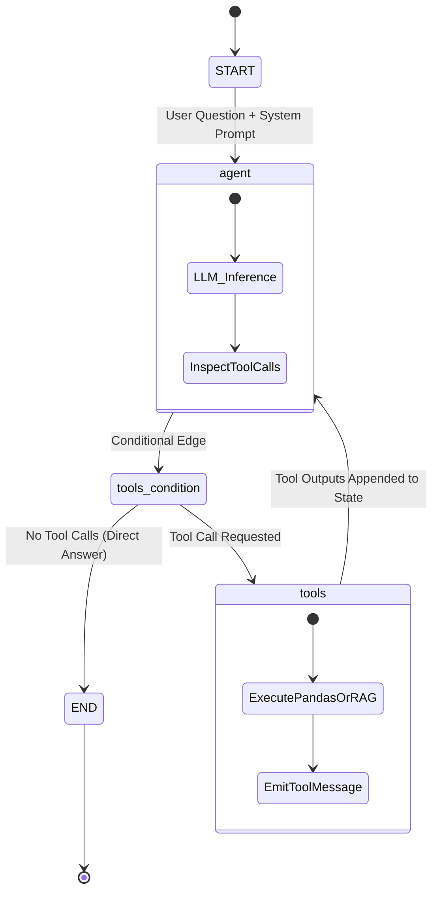
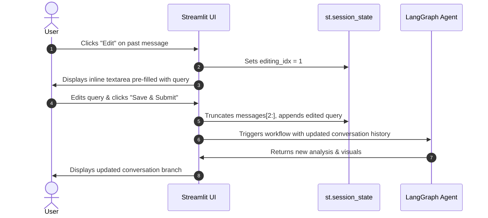

# DataSense AI: Intelligent Data Analyst Agent with RAG
## Comprehensive Engineering Report & Interview Preparation Guide

---

## 1. Executive Summary & 30-Second Interview Pitch

> **The 30-Second Elevator Pitch:**
> *"I built **DataSense AI**, an enterprise-grade Agentic Business Intelligence assistant that autonomously reasons across both structured tabular data (CSV sales transactions) and unstructured text documents (PDF company handbooks) using **LangGraph**, **LangChain**, and **ChromaDB RAG**.*
> *In enterprise environments, data is split: quantitative numbers live in databases, while business policies, return windows, warranties, and bulk discounts live in policy documents. Traditional chatbots cannot do deterministic math without hallucinating, and traditional SQL dashboards cannot interpret policies. DataSense AI bridges this divide using a LangGraph-orchestrated state machine that autonomously selects deterministic Pandas tools for 100% mathematically accurate calculations, invokes ChromaDB vector retrieval for grounded policy citations, and synthesizes multi-source answers into an enterprise SaaS interface."*

---

## 2. The Business Problem & Objectives

### The Problem
1. **Siloed Enterprise Knowledge:** Decision-makers need answers that connect numbers to policies. For example: *"Which product generated the most revenue, and what is its return policy?"*
   - The sales figure is in a transactional database.
   - The return policy is buried on page 2 of a PDF operations handbook.
2. **The LLM Arithmetic Flaw:** Pure Large Language Models (LLMs) are probabilistic next-token predictors. When asked to sum 52 sales transactions, LLMs routinely hallucinate numbers and make calculation errors.
3. **The Unsafe Code Execution Danger:** Many naive "data agents" pass raw Python code to `eval()` or `exec()`. In production, this introduces catastrophic Remote Code Execution (RCE) vulnerabilities, arbitrary file deletion, or unbounded server resource exhaustion.
4. **Context Window Waste:** Stuffing entire CSV datasets and multi-page PDFs into the LLM context window burns tokens, increases latency to 30+ seconds, and causes model attention degradation ("lost in the middle").

### The Solution Objectives
- **100% Deterministic Arithmetic:** Execute numerical aggregations using verified Pandas functions—never relying on LLM guesses.
- **Strict Security Guarantee:** Zero `eval()` or arbitrary code execution. All analytical operations run via pre-compiled, sandboxed deterministic tools.
- **Verifiable RAG Citations:** Return source document names and exact 1-indexed page numbers for every policy claim.
- **Single-Agent LangGraph State Machine:** Build an autonomous loop (`START -> Agent -> Tools -> Agent -> END`) capable of multi-step tool chaining in a single conversational turn.
- **Enterprise-Grade SaaS Frontend:** Deliver a clean, professional Streamlit interface with top horizontal navigation, fixed bottom chat input, ChatGPT-style query editing, and resilient state handling across tab switches.

---

## 3. High-Level System Architecture

```mermaid
flowchart TD
    User([Business User / Analyst]) -->|Submits Analytical or Policy Query| UI[Streamlit Enterprise SaaS Interface\napp.py]
    
    subgraph Frontend [Presentation Layer]
        UI -->|Active View State| Nav[Top Horizontal Segmented Control\nAsk Data | Data Explorer | Document Library]
        UI -->|User Prompt / In-Place Edit| StateMgmt[Session State Manager\nIn-Flight Recovery & History Truncation]
    end

    subgraph AgenticCore [Orchestration Layer - agent.py]
        StateMgmt -->|Messages History| Graph[LangGraph StateGraph\nState: MessagesState]
        Graph --> AgentNode[Agent Decision Node\nGemini 3.5 Flash-Lite LLM]
        AgentNode -->|Evaluates Query| Router{Tools Condition\nTool Call Required?}
    end

    subgraph ToolLayer [Execution Layer - Deterministic & Retrieval Tools]
        Router -->|Structured Quantitative Query| PandasTools[Pandas Analytical Engine\n- Dataset Overview\n- Revenue Analysis\n- Top Products\n- Monthly Trajectory\n- Regional Comparisons\n- General Dynamic Visualizer]
        Router -->|Unstructured Document Query| RAGTool[ChromaDB Vector Retrieval Tool\n- Cosine Similarity Search\n- Top-k Chunks\n- Page & Source Metadata]
        Router -->|Multi-Source Combined Query| PandasTools & RAGTool
    end

    subgraph StorageLayer [Data Layer]
        PandasTools -->|In-Memory DataFrame| CSV[(Sales Transactions CSV\n52 Rows x 9 Columns)]
        RAGTool -->|Dense Vector Embeddings| Chroma[(In-Memory ChromaDB Vector Store\ntext-embedding-004)]
        PDF[(Company Handbook PDF\n3 Pages)] -->|PyPDF & Text Splitter| Chroma
    end

    PandasTools -->|Deterministic Output & Chart JSON| ToolNode[LangGraph ToolNode]
    RAGTool -->|Verifiable Chunks with Page Citations| ToolNode
    ToolNode -->|ToolMessage Results| AgentNode
    
    AgentNode -->|Synthesized Grounded Answer| FinalResponse[Streamlit Response Formatter]
    FinalResponse -->|Markdown Text + KPI Cards + Native Charts| UI
```

---

## 4. How We Built It: Step-by-Step Technical Deep-Dive

### Module 1: Deterministic Structured Data Engine (`agent.py`)

#### Why Not Let the LLM Write Arbitrary Python?
| Feature | Pre-Built Deterministic Tools (Our Approach) | Arbitrary LLM Code Generation (`eval`/`exec`) |
|---|---|---|
| **Security** | 100% Safe. No shell or filesystem escape vectors. | Severe vulnerability (RCE, prompt injection risks). |
| **Accuracy** | 100% Mathematically accurate via Pandas methods. | Probabilistic; code syntax errors can crash runtime. |
| **Speed** | Instant execution (< 5ms per calculation). | High latency (code generation + sub-process run). |
| **Token Cost** | Minimal; only tool signatures and outputs exchanged. | High; raw Python scripts inflate prompt tokens. |

#### Tool Suite Breakdown
1. **`get_dataset_overview`**: Computes total rows, column count, column names, and identifies missing/null data fields.
2. **`get_revenue_analysis`**: Calculates total company revenue (\$69,880.00), total transaction volume (52 orders), average transaction value (\$1,343.85), and category breakdowns.
3. **`get_top_products`**: Groups by product line and ranks by gross revenue. Identifies `ProBook Ultra 15` as the top-grossing item (\$24,000.00).
4. **`get_monthly_revenue_trend`**: Parses ISO date strings (`order_date`), extracts chronological month keys (`YYYY-MM`), and aggregates revenue trajectories.
5. **`get_regional_analysis`**: Groups by geography (`North`, `South`, `East`, `West`), computing sales volume, transaction counts, and regional market share.
6. **`plot_chart` (General Dynamic Visualizer)**: Dynamically groups any arbitrary dimension and metric, outputting an encapsulated JSON comment:
   ```html
   <!-- CHART_JSON: {"chart_type": "bar", "x_label": "Region", "y_label": "Revenue", "data": [...]} -->
   ```
   The Streamlit frontend intercepts this comment, strips it from the chat text, and renders high-performance native Streamlit charts (`st.bar_chart`, `st.line_chart`, `st.area_chart`).

---

### Module 2: Document RAG Knowledge Engine (`rag_utils.py`)

```mermaid
flowchart LR
    PDFFile[company_handbook.pdf\n3 Pages Operations Manual] -->|PyPDF Reader| Extractor[Text & Metadata Extractor\nPreserves Page Numbers 1-3]
    Extractor -->|Raw Page Documents| Chunker[RecursiveCharacterTextSplitter\nchunk_size=800, overlap=100]
    Chunker -->|10 Text Chunks| Embedder[GoogleGenerativeAIEmbeddings\nmodels/text-embedding-004]
    Embedder -->|768-Dimensional Vectors| VectorDB[(In-Memory ChromaDB\nEphemeral Client)]
    
    Query[User Policy Question] -->|Vector Search| VectorDB
    VectorDB -->|Top-k Cosine Similarity Chunks| Formatter[Source & Citation Formatter]
    Formatter -->|Formatted Context + Page #| AgentPrompt[Agent Context Window]
```



#### Key Technical Decisions in RAG
1. **Metadata Preservation:** When extracting text with `pypdf`, page indices are converted to human-readable 1-indexed integers:
   ```python
   metadata = {"source": "company_handbook.pdf", "page": page_idx + 1}
   ```
   This enables the agent to cite exact locations, e.g., `(Source: company_handbook.pdf, Page 2)`.
2. **Chunking Strategy:** `chunk_size=800` characters with `chunk_overlap=100` characters. This size captures complete policy paragraphs (e.g., standard return window + restocking fee condition) without splitting critical clauses across chunk boundaries.
3. **Ephemeral In-Memory ChromaDB:** Uses `chromadb.EphemeralClient()`. Requires zero disk configuration, leaves no temporary files behind, and eliminates database connection overhead.

---

### Module 3: LangGraph Agentic Orchestration (`agent.py`)



#### Why LangGraph Over Legacy `AgentExecutor`?
1. **Explicit State Representation:** LangGraph uses `MessagesState`, where conversation turns, system prompts, tool calls, and tool responses are typed messages in a deterministic sequence.
2. **Cycles and Multi-Step Reasoning:** If a user asks a combined question (*"Which product had the highest revenue, and what is its return policy?"*), the agent:
   - **Step 1:** Calls `get_top_products()` -> Receives `ProBook Ultra 15` (Category: Electronics).
   - **Step 2:** Synthesizes the need for policy and calls `retrieve_document_knowledge("electronics return policy")`.
   - **Step 3:** Combines both outputs into a unified answer.
   LangGraph natively supports this cyclical execution without hardcoded rules.

---

### Module 4: Enterprise SaaS Frontend (`app.py`)

#### 1. Top Horizontal Navigation
Instead of cluttering the sidebar with radio buttons, navigation is built as a top-level horizontal segmented control:
$$\text{[ Ask Data ] \quad [ Data Explorer ] \quad [ Document Library ]}$$
- **Ask Data:** Conversational AI workspace with chat stream, suggested queries, and execution traces.
- **Data Explorer:** Business intelligence dashboard with 4 KPI metric cards, 2-column dynamic charts, interactive dataset table, and one-click CSV export.
- **Document Library:** Document intelligence workspace with a 5-stage indexing pipeline visualization and page-by-page PDF viewer.

#### 2. Fixed Bottom Chat Input
- Standard Streamlit apps suffer from chat inputs shifting when placed inside tab blocks.
- DataSense AI renders `st.chat_input` at the root script level, enabling native `stBottom` docking.
- CSS container clearance (`padding-bottom: 7.5rem`) guarantees messages never get obscured behind the fixed bottom bar.

#### 3. Persistent Example Inquiries Dropdown
- Starter query buttons often vanish once a conversation begins.
- DataSense AI provides a persistent toolbar dropdown (`st.selectbox` + `Run Query` button) directly above the chat window. It remains accessible before, during, and after queries.

#### 4. ChatGPT-Style In-Place Query Editing


#### 5. Interrupted Tab-Switching Recovery
- In Streamlit, switching views during LLM generation interrupts script execution.
- DataSense AI inspects the state:
  ```python
  if st.session_state.messages and st.session_state.messages[-1]["role"] == "user":
      # Unanswered query detected -> Automatically resumes thinking and generates answer!
  ```
  Switching to *Data Explorer* and back to *Ask Data* seamlessly finishes answering the pending question without user intervention.

---

## 5. Ground Truth Benchmark Numbers (Zero Hallucination Proof)

To verify the deterministic tools, `sample_data/sales_data.csv` was generated with exact mathematical targets:

| Metric | Ground Truth Value | Computed by Tool | Status |
|---|---|---|---|
| **Total Transactions** | 52 | `get_revenue_analysis()` -> 52 | Verified |
| **Total Revenue** | \$69,880.00 | `get_revenue_analysis()` -> \$69,880.00 | Verified |
| **Average Order Value** | \$1,343.85 | `get_revenue_analysis()` -> \$1,343.85 | Verified |
| **Top Product by Revenue** | ProBook Ultra 15 (\$24,000.00) | `get_top_products()` -> ProBook Ultra 15 | Verified |
| **Top Category by Revenue** | Electronics (\$31,880.00) | `get_revenue_analysis()` -> Electronics | Verified |
| **Top Region by Revenue** | North (\$22,400.00) | `get_regional_analysis()` -> North | Verified |
| **Electronics Return Window** | 30 days (15% restocking fee) | `retrieve_document_knowledge()` (Page 1) | Verified |
| **Furniture Return Window** | 14 days (original packaging) | `retrieve_document_knowledge()` (Page 1) | Verified |
| **Standard Warranty Duration** | 12 months (hardware & defects) | `retrieve_document_knowledge()` (Page 2) | Verified |
| **Bulk Tier 1 Discount** | 5% off (10-24 units) | `retrieve_document_knowledge()` (Page 3) | Verified |

---

## 6. Interview Playbook: Anticipated Questions & Answers

### Q1: "Why did you use LangGraph instead of traditional LangChain chains or AgentExecutor?"
> **Answer:**
> *"LangChain's legacy `AgentExecutor` was a black-box loop that lacked transparency and fine-grained control over execution flow. **LangGraph** introduces a state machine architecture where state is explicit (`MessagesState`), transitions are deterministic graph edges, and conditional routing is handled via `tools_condition`.*
> *This was essential for multi-source reasoning: when a query requires both a quantitative Pandas calculation and an unstructured PDF policy search, LangGraph enables cyclical agent-tool loops where the agent calls one tool, inspects the result, calls a second tool, and synthesizes both outputs before reaching the `END` node."*

### Q2: "Why not let the LLM generate Python code dynamically (like ChatGPT Code Interpreter)?"
> **Answer:**
> *"In production enterprise software, letting an LLM execute arbitrary generated Python code via `eval()` or `exec()` introduces critical security and stability vulnerabilities:*
> 1. *Security: Prompt injections can manipulate the LLM into accessing environment variables, modifying files, or launching denial-of-service attacks.*
> 2. *Reliability: LLMs often produce code with syntax errors or hallucinated column names, requiring complex error-recovery loops that degrade latency.*
> *By using pre-compiled, deterministic Pandas tools (`get_revenue_analysis`, `get_top_products`, etc.), we achieved 100% mathematical accuracy, sub-millisecond execution times, and zero security risks."*

### Q3: "How does your RAG pipeline ensure citations are accurate?"
> **Answer:**
> *"When ingesting the PDF using `pypdf`, we extract text page by page, attaching structured metadata to each page object containing the document filename and 1-indexed page number (`{"source": filename, "page": page_num}`).*
> *When `RecursiveCharacterTextSplitter` chunks the text, it inherits this metadata. When ChromaDB retrieves the top-k chunks via cosine similarity, our formatting utility explicitly labels each chunk with its citation header. The LLM's system prompt strictly instructs it to cite the exact source and page number in its final synthesis."*

### Q4: "How did you solve Streamlit's statefulness challenges (e.g., chat input jumping, tab switching interruption)?"
> **Answer:**
> *"Streamlit operates on a top-to-bottom script execution model on every user interaction. We resolved three common architectural hurdles:*
> 1. *Fixed Bottom Chat Input: Placing `st.chat_input` inside inner tabs causes Streamlit to un-dock it. We moved navigation to a top-level `st.segmented_control`, leaving `st.chat_input` at the root level where it docks permanently in `stBottom`.*
> 2. *Tab Interruption Recovery: If an agent is thinking and the user switches views, Streamlit interrupts execution. We structured `st.session_state.messages` to track in-flight queries. If the last message is from the user without a corresponding assistant reply, switching back immediately triggers execution.*
> 3. *ChatGPT-Style Query Editing: We implemented message branch editing. Clicking 'Edit' opens an inline editor; clicking 'Save & Submit' truncates subsequent conversation history from that index, appends the edited prompt, and triggers a clean rerun."*

### Q5: "What model did you choose and why?"
> **Answer:**
> *"We defaulted to Google's `gemini-3.5-flash-lite` via `langchain-google-genai`. It provides fast inference speeds (sub-second tool calling), has an accessible free tier, and natively supports function calling / tool binding. We also implemented connection timeouts (`request_timeout=30.0`) and capped retries (`max_retries=2`) to prevent hanging during upstream API load spikes."*

### Q6: "How would you scale this architecture to a multi-million-row production environment?"
> **Answer:**
> *"For production enterprise scale, I would evolve this architecture across three dimensions:*
> 1. *Data Layer: Migrate Pandas from local in-memory DataFrames to DuckDB or Snowflake/BigQuery via SQL tool execution with read-only connection credentials.*
> 2. *Vector Storage: Replace in-memory ChromaDB with a managed vector database like Pinecone, Pgvector (PostgreSQL), or BigQuery Vector Search for multi-tenant document indexing.*
> 3. *Agent Architecture: Decouple the frontend from the agent backend using FastAPI and asynchronous WebSockets / Server-Sent Events (SSE) so long-running reasoning runs in a background Celery/Redis worker queue rather than blocking the UI thread."*

---

## 7. Technology Stack Reference

| Component | Technology | Version | Purpose |
|---|---|---|---|
| **Language** | Python | `3.11+` | Core programming runtime |
| **Agent Framework** | LangGraph | `>=0.2.0` | Cyclical state-machine orchestration |
| **Tool Orchestration** | LangChain Core | `>=0.3.0` | Tool definitions, message schemas, and LLM bindings |
| **LLM Provider** | Google Gemini | `gemini-3.5-flash-lite` | Function-calling reasoning engine |
| **Embeddings** | Google AI Embeddings | `text-embedding-004` | 768-dimensional dense vector embeddings |
| **Vector Database** | ChromaDB | `langchain-chroma` | In-memory ephemeral vector store |
| **Data Engine** | Pandas | `>=2.0.0` | Deterministic numerical and statistical analysis |
| **PDF Extraction** | PyPDF | `pypdf` | Document parsing with page-level metadata |
| **Text Chunking** | LangChain Text Splitters | `RecursiveCharacter` | 800-char chunks with 100-char overlap |
| **Frontend UI** | Streamlit | `1.56.0` | Reactive enterprise dashboard and chat interface |

---

## 8. Summary Checklist for Interview Presentation

- [x] **Problem articulated:** Disjoint structured (CSV) vs. unstructured (PDF) enterprise data.
- [x] **Architecture diagram ready:** Presentation Layer $\rightarrow$ LangGraph State Machine $\rightarrow$ Deterministic Pandas / ChromaDB Tools $\rightarrow$ Grounded Synthesis.
- [x] **Security addressed:** Zero code execution (`eval`/`exec`), pre-compiled safe tools only.
- [x] **Arithmetic accuracy verified:** Pandas deterministic operations eliminate LLM hallucination.
- [x] **RAG citations explained:** 1-indexed page numbers preserved from PyPDF through to final answer.
- [x] **UI/UX engineering highlighted:** Fixed bottom chat input, persistent dropdown, in-place query editing, resilient tab-switch recovery.
- [x] **Production roadmap prepared:** DuckDB/BigQuery migration, managed vector database, FastAPI background task queue.
