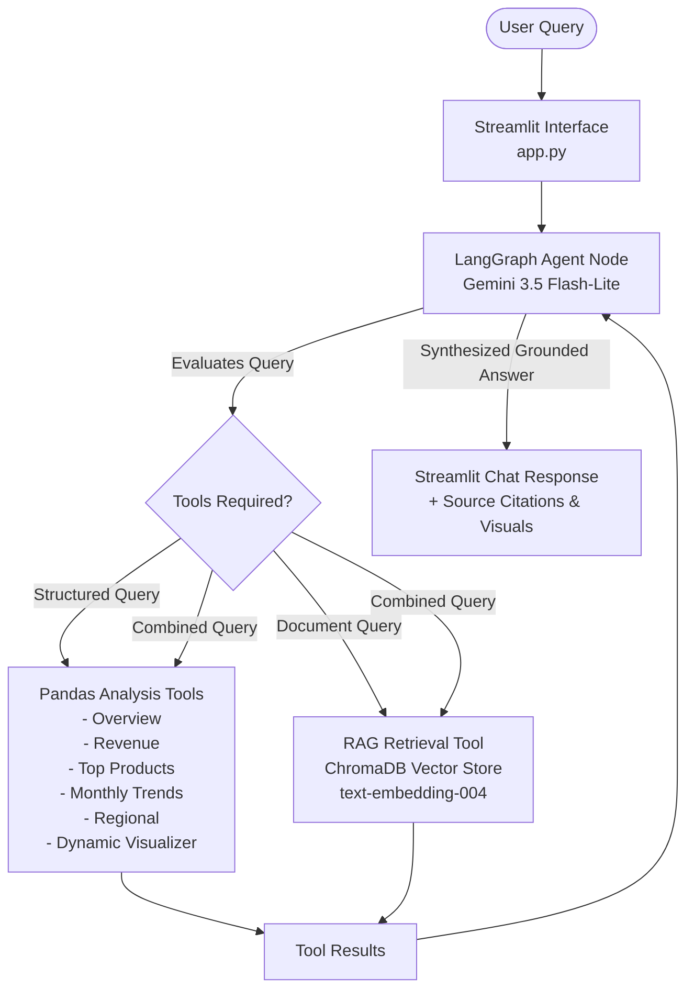

# DataSense AI: Intelligent Data Analyst Agent with RAG

An enterprise-grade Agentic Business Intelligence assistant built using **LangChain**, **LangGraph**, and **Retrieval-Augmented Generation (RAG)** with **ChromaDB**.

The agent autonomously analyzes structured e-commerce sales transactions (CSV) alongside unstructured company policy handbooks (PDF) to answer complex business questions, including combined analytical and document retrieval queries.

---

## Key Features

- **Structured Data Analysis:** High-performance Pandas-based deterministic analytical tools for dataset overviews, revenue breakdowns, category summaries, monthly chronological sales trends, and regional comparisons.
- **Document RAG with ChromaDB:** End-to-end PDF ingestion, chunking with `RecursiveCharacterTextSplitter`, semantic vector search with `GoogleGenerativeAIEmbeddings`, and in-memory ChromaDB vector store.
- **Agentic Workflow with LangGraph:** Deterministic agent-tool loop using `StateGraph`, `MessagesState`, and `tools_condition` routing:
  $$\text{START} \longrightarrow \text{Agent} \longleftrightarrow \text{Tools} \longrightarrow \text{Final Response}$$
- **Multi-Tool Synthesis (Combined Queries):** Autonomously decomposes multi-part queries (e.g., finding the top-selling electronics product from CSV and retrieving its return policy from PDF) in a single conversational turn.
- **Source Citation & Traceability:** Returns exact source file names and 1-indexed page numbers for retrieved document context.
- **Modern Enterprise SaaS UI:** Built with Streamlit 1.56 featuring top horizontal segmented control navigation, fixed bottom chat input, ChatGPT-style in-place query editing, persistent demo query dropdowns, and resilient in-flight query recovery across tab switches.

---

## System Architecture



---

## Project Directory Structure

```
DataSense-AI/
│
├── app.py                   # Streamlit web application & session state
├── agent.py                 # LangGraph workflow, system prompt & Pandas tools
├── rag_utils.py             # PDF loading, chunking, embeddings & ChromaDB setup
│
├── sample_data/
│   ├── sales_data.csv       # 52 synthetic e-commerce sales transactions
│   └── company_handbook.pdf # Synthetic 3-page company operations & policy handbook
│
├── requirements.txt         # Pinned application dependencies
├── LICENSE                  # MIT License
├── .env.example             # Environment template for API keys
├── .gitignore               # Git exclusion rules
└── README.md                # Project documentation
```

---

## Technology Stack

| Component | Technology | Purpose |
|---|---|---|
| **Programming Language** | Python 3.11+ | Core application logic |
| **Orchestration Framework** | LangGraph (`>=0.2.0`) | State graph workflow with cyclical agent-tool loops |
| **LLM & Tool Calling** | LangChain Google GenAI | `gemini-3.5-flash-lite` model integration |
| **Embeddings** | Google Generative AI | `models/text-embedding-004` (768-dim embeddings) |
| **Vector Database** | ChromaDB (`langchain-chroma`) | In-memory ephemeral vector store for fast retrieval |
| **Data Manipulation** | Pandas (`>=2.0.0`) | Deterministic structured data calculations |
| **Document Processing** | PyPDF (`pypdf`) | PDF text extraction and page metadata preservation |
| **Text Chunking** | LangChain Text Splitters | `RecursiveCharacterTextSplitter` (800 chars, 100 overlap) |
| **User Interface** | Streamlit (`1.56.0`) | Reactive web interface with top segmented navigation |
| **Configuration** | python-dotenv | Secure environment variable management |

---

## Getting Started

### 1. Clone the Repository

```bash
git clone https://github.com/Ravi110296/DataSense-AI.git
cd DataSense-AI
```

### 2. Create and Activate a Virtual Environment

```bash
# Windows
python -m venv .venv
.venv\Scripts\activate

# macOS / Linux
python3 -m venv .venv
source .venv/bin/activate
```

### 3. Install Dependencies

```bash
pip install -r requirements.txt
```

### 4. Configure Your API Key

Obtain a free Google Gemini API key from [Google AI Studio](https://aistudio.google.com/).

Create a `.env` file from the example template:

```bash
cp .env.example .env
```

Open `.env` and add your key:
```ini
GEMINI_API_KEY=your_actual_gemini_api_key_here
```

*(Note: You can also enter or change your API key directly in the Streamlit sidebar at runtime).*

### 5. Run the Application

```bash
streamlit run app.py
```

Click **"Load Demo Dataset & Handbook"** in the sidebar to immediately explore the data and ask questions.

---

## Evaluation & Sample Scenarios

The sample dataset contains 52 transactions across 4 categories (*Electronics, Home & Kitchen, Furniture, Sports & Fitness*) and 4 regions (*North, South, East, West*). The synthetic handbook contains category return policies, warranty terms, and volume discount rules.

### Test 1: Structured Data Query
- **Question:** *"Which product generated the highest revenue?"*
- **Invoked Tool:** `get_top_products`
- **Expected Output:** **ProBook Ultra 15** in the Electronics category with **$24,000.00** total revenue (20 units sold).

### Test 2: Document Retrieval (RAG)
- **Question:** *"What is the return policy for electronics?"*
- **Invoked Tool:** `retrieve_document_knowledge`
- **Expected Output:** 30-day return window from delivery date; must be in original packaging with accessories; **15% restocking fee** if opened without defect (cited from `company_handbook.pdf`, Page 1).

### Test 3: Combined Multi-Tool Query
- **Question:** *"Which electronics product generated the highest revenue, and what is its return policy?"*
- **Invoked Tools:** `get_top_products` + `retrieve_document_knowledge`
- **Expected Output:** Identifies **ProBook Ultra 15** ($24,000.00 revenue) and explains its 30-day return window, original packaging requirements, and 15% restocking fee, citing `company_handbook.pdf`.

### Test 4: Conversational Follow-Up
- **Question:** *"What about its warranty?"*
- **Invoked Tool:** `retrieve_document_knowledge`
- **Expected Output:** Uses conversation history to refer to the ProBook Ultra 15 / Electronics warranty: 2-year limited manufacturer warranty on internal hardware/display, 1-year battery coverage.

### Test 5: Missing Information Handling
- **Question:** *"What is the return policy for musical instruments?"*
- **Invoked Tool:** `retrieve_document_knowledge`
- **Expected Output:** The agent acknowledges that musical instruments are not covered in the company handbook instead of fabricating policies.

---

## Current Limitations & Future Work

- **In-Memory Vector Store:** Current ChromaDB instance uses an ephemeral in-memory client. Future iterations can connect to persistent ChromaDB, PGVector, or Pinecone.
- **Fixed Tool Schema:** Analytical operations use predefined Pandas functions to avoid unvalidated code execution risks (`eval`/`exec`). Complex ad-hoc analytical inquiries could be handled using sandboxed code-interpreter environments.
- **Single Agent Pattern:** Uses a single-agent orchestrator with tool-calling capabilities. Can be extended to a supervisor-worker multi-agent system using LangGraph subgraphs.

---

## License

This project is licensed under the MIT License - see the [LICENSE](LICENSE) file for details. Fictional business data is provided solely for educational and portfolio demonstration.
